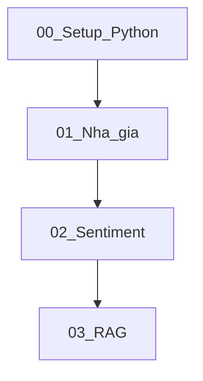

# Curriculum Jupyter: Nền tảng trước, RAG sau

## Quyết định đã chốt

- Học viên: biết lập trình ngôn ngữ khác, **Python gần như mới**.
- Ưu tiên: **nền tảng vững** rồi mới chatbot RAG (không nhảy thẳng PDF RAG).
- Phạm vi MVP dạy bạn: Setup → Python ngắn → Dự án 1 → Dự án 2 (rút gọn) → RAG.
- YOLO / Recommendation / Meeting AI: **không làm trong giai đoạn này**.

## Cấu trúc repo đề xuất

```
AIOT/
  docs/                          # tài liệu gốc (đã có)
  notebooks/
    00_setup_and_python/
    01_house_price/
    02_sentiment/
    03_rag_chatbot/
  data/                          # dataset mẫu (nhỏ, commit được hoặc script download)
  requirements/
    base.txt
    ml.txt
    rag.txt
  README.md                      # cách cài môi trường + thứ tự học
```

Mỗi notebook theo cùng template: mục tiêu → kiến thức cần nhớ → code có chú thích tiếng Việt → bài tập nhỏ → checklist “đã hiểu khi…”.

## Lộ trình học (5 giai đoạn)



### Giai đoạn 0 — Setup + Python cho người đã biết code (~1 buổi)

Notebook: `notebooks/00_setup_and_python/00_python_for_coders.ipynb`

- Cài Python 3.11+, venv, Jupyter Lab.
- Map khái niệm từ ngôn ngữ cũ → Python: biến, hàm, list/dict, f-string, `if/for`, đọc file, `pip`, import.
- Pandas tối thiểu: `read_csv`, chọn cột, lọc hàng, `describe()`.
- Không dạy OOP sâu; chỉ đủ để đọc code ML.

**Đầu ra:** học viên tự chạy được notebook và thao tác DataFrame đơn giản.

### Giai đoạn 1 — Dự đoán giá nhà (Level 1 dự án 1)

Notebook: `notebooks/01_house_price/01_train_and_predict.ipynb`

Bám [docs/Lộ trình học AI cho Lập trình viên.pdf](docs/Lộ%20trình%20học%20AI%20cho%20Lập%20trình%20viên.pdf):

- Load dataset giá nhà (dataset công khai nhỏ, ví dụ California/housing hoặc CSV tiếng Việt giả lập).
- EDA ngắn: phân phối giá, tương quan diện tích/phòng ngủ.
- Train/test split → mô hình Scikit-learn (Linear Regression hoặc Random Forest).
- Đánh giá: MAE/RMSE; thử dự đoán với input mới.
- Cell “giải thích cho bạn”: supervised learning, feature, label, overfitting (1 đoạn ngắn).

**Đầu ra:** hiểu pipeline dữ liệu → model → dự đoán, không cần API.

### Giai đoạn 2 — Sentiment rút gọn (Level 1 dự án 2)

Notebook: `notebooks/02_sentiment/02_text_classify.ipynb` (+ optional `03_fastapi_stub.ipynb` hoặc script mỏng)

- Dataset bình luận ngắn (tiếng Việt hoặc song ngữ đơn giản).
- Bag-of-words / TF-IDF + Naive Bayes hoặc Logistic Regression (Scikit-learn).
- Đánh giá accuracy/F1 trên tập test.
- FastAPI: chỉ 1 endpoint `POST /predict` — có thể tách file `.py` ngắn, không bắt buộc production.

**Bỏ / hoãn:** VnCoreNLP nếu cài đặt phức tạp trên Windows; dùng tokenization đơn giản trước.

**Đầu ra:** thấy NLP cổ điển khác gì tabular ML; chuẩn bị tư duy cho embedding ở RAG.

### Giai đoạn 3 — Chatbot RAG (dùng PDF hướng dẫn)

Notebooks tách bước cho dễ dạy (không nhét 1 file dài):

1. `03a_load_split_pdf.ipynb` — load PDF, chunk, overlap  
2. `03b_embeddings_chroma.ipynb` — embedding + Chroma  
3. `03c_rag_qa.ipynb` — prompt + chain + hỏi đáp  

Bám [docs/Xây dựng Chatbot RAG PDF.pdf](docs/Xây%20dựng%20Chatbot%20RAG%20PDF.pdf): LangChain, OpenAI (hoặc Gemini nếu sau này đổi), ChromaDB, `pypdf`.

- Dùng chính 2 PDF trong `docs/` làm corpus demo (học viên hỏi về lộ trình / RAG).
- API key qua biến môi trường / `.env` (không hardcode trong notebook).
- System prompt ép “không bịa”; demo câu hỏi trong / ngoài tài liệu.

**Đầu ra:** học viên giải thích được pipeline PDF → chunk → vector → retrieve → LLM.

## Thứ tự triển khai kỹ thuật (khi bạn bảo execute)

1. Tạo cấu trúc folder + `README.md` + `requirements/*.txt`.
2. Viết notebook **00** (setup + Python).
3. Viết notebook **01** + dataset mẫu trong `data/`.
4. Viết notebook **02** (sentiment rút gọn).
5. Viết bộ notebook **03a–03c** RAG theo PDF hướng dẫn, corpus = `docs/`.
6. Smoke-test: chạy tuần tự trên máy Windows (venv + Jupyter).

## Liên kết tới Microsoft Store (chỉ định hướng, chưa build app)

- Mỗi giai đoạn Jupyter = 1 “module” nội dung sau này trong app.
- Giữ markdown mục tiêu/checklist ổn định để sau convert sang lesson UI.
- **Không** thiết kế Store packaging trong MVP notebook này.

## Phạm vi cố ý không làm ngay

- YOLOv8, recommendation, trợ lý họp.
- App WinUI / MS Store packaging.
- Production vector DB (Pinecone…) — giữ Chroma local.
